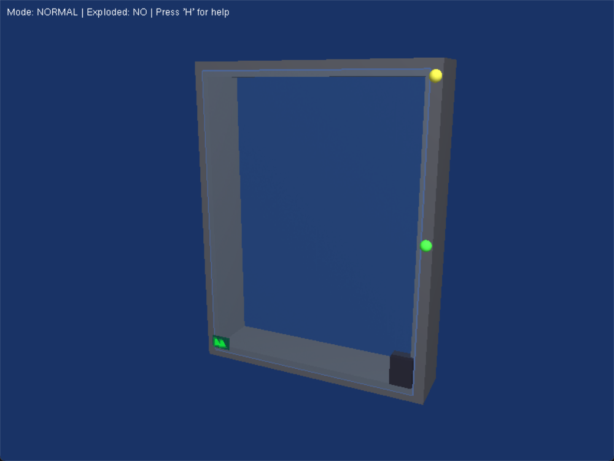
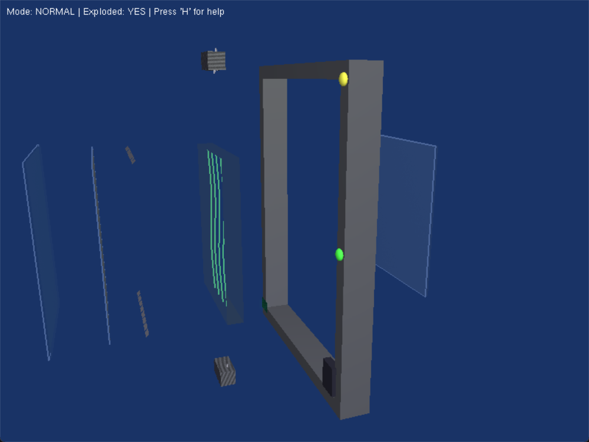

# Intelligent Window System (IWS)

An interactive 3D model of a smart, climate-adaptive window, written in C++ with OpenGL and freeGLUT.

It models a window with several layers that work together: smart glass that changes its tint, a solar coating, an airflow chamber with cooling fans and micro vents, an insulated inner pane, and a frame with sensors. You can switch climate modes and watch the parts respond, or pull the window apart into an exploded view to see how it's built.

<p align="center">
  
  
</p>

## Features

- **Layered window model:** outer smart glass, a solar coating, an airflow chamber, an inner insulated pane and a frame with sensors
- **Animated parts:** top and bottom cooling fans, opening and closing micro vents, and lines showing the airflow
- **Climate modes** that change the glass tint, vents and fans together:

  | Mode | Glass | Vents | Fans |
  |---|---|---|---|
  | HOT | Dark tint | Fully open | Fast |
  | COLD | Clear | Closed | Off |
  | NORMAL | Light tint | Half open | Normal speed |

- **Exploded view:** separates the layers along the depth axis, with an adjustable spread
- **Procedural textures:** the metal, glass and display textures are generated in code, so there are no image files to load
- **Free camera:** orbit with the mouse or keyboard, and zoom in or out
- Lighting you can turn on and off, and an on-screen status bar

## Controls

| Input | Action |
|---|---|
| Left-drag / Arrow keys | Orbit the camera |
| `Z` / `X` | Zoom in / out |
| `A` / `D` | Roll around the Z-axis |
| `1` / `2` / `3` | HOT / COLD / NORMAL mode |
| `T` / `Y` | Increase / decrease the glass tint |
| `F` / `G` | Turn the top / bottom fan on or off |
| `V` | Animate the vents |
| `E` | Turn the exploded view on or off |
| `+` / `-` | Increase / decrease the explosion distance |
| `L` / `K` | Light on / off |
| `H` | Print the controls to the console |
| `Esc` | Quit |

## Building

The whole program is one file, `main.cpp`. It needs a C++ compiler plus OpenGL, GLU and GLUT (freeGLUT).

### Windows

1. Install [MSYS2](https://www.msys2.org/), then in the **MSYS2 UCRT64** terminal run:
   ```sh
   pacman -S mingw-w64-ucrt-x86_64-gcc mingw-w64-ucrt-x86_64-freeglut
   ```
2. Double-click **`build.bat`**. It finds a MinGW `g++` that has freeGLUT, builds `iws.exe` and starts it.

`build.bat` checks your `PATH` and the usual MinGW install folders. To use a specific compiler, set `CXX` first, for example `set CXX=C:\path\to\g++.exe`. freeGLUT is linked statically, so the finished `iws.exe` doesn't need a separate `freeglut.dll`.

### Linux

```sh
sudo apt install g++ make freeglut3-dev   # Debian / Ubuntu
make run
```

### macOS

GLUT comes with macOS, so you only need the Xcode command line tools:

```sh
xcode-select --install
make run
```

## Project structure

```
main.cpp     Scene, rendering, animation and input handling
build.bat    One-click build and run for Windows
Makefile     Build for Windows (MinGW), Linux and macOS
docs/        Screenshots
```

## Tech

C++ · OpenGL (fixed-function pipeline) · GLU · freeGLUT
